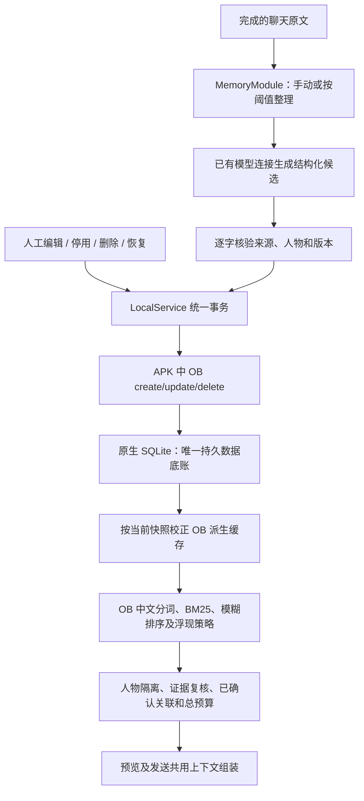

# Android 内置 OB 记忆底座

本轮把此前外接只读网关替换为 Android APK 内的 Python/OB。手机自行执行记忆写入和召回，没有记忆服务 URL、额外口令、电脑进程或 MCP 的运行依赖。网页版保留原实现，后续统一。

## 完整流程与数据所有者



- SQLite 继续保存人物、聊天原文、记忆卡片、逐字依据、版本、标签、关联、每日总结与整理进度。名册仍由用户明确编辑。
- MemoryModule 继续负责候选提取和来源校验；生成使用已有主/副模型预设，不增加第二份模型配置。提取失败不推进整理进度。
- TMemory 只有一个 JSON 命令接口，不读取 API 密钥、不联网、不直接写业务数据库；单线程执行实际 Python OB。
- OB 保存 Markdown 派生文件、原生索引和策略状态到 App 私有缓存。它们可以删除后自动重建，不作为第二套待同步的记忆库，不单独要求备份。
- 写入先让 OB 接受候选，再原子保存 SQLite，最后发布新状态。任一步失败都不发布候选；下一操作从当前已保存快照校正派生缓存。修改前来源再次核验。
- 每次召回先对齐当前快照，因此 SQLite 保存失败、进程退出、缓存清理和旧备份恢复不会让未提交卡片进入新上下文。旧事件 ID、证据、版本和业务文档 version 2 不变。

## 从既有实现保留什么

Android 的记忆事件候选排序替换为固定版 OB，浏览器继续使用原 Serein JS 词法实现。近期用户线索、人工核心标签、经确认的单跳关联、矛盾标记、逐字证据、同人物边界和字符预算继续由原领域规则控制。人工标签的本地词法匹配是标签选择规则，并非第二套事件记忆库。

Android 不调用旧的外部网关，即使旧备份保存了 enabled 配置。入口变为「内置 OB · 运行状态」；旧字段保留兼容，不上传或迁移远程 OB 数据。网页外部网关原型保留供原有评测使用。

OB 原文件保持不变。适配层：

- 固定 `BucketManager` 的真实目录路径，兼容 Android 的 `/data/data` 软链接；按人物哈希分目录，事件标识映射为稳定哈希。
- 用 OB 支持的批次字段保存记录快照摘要；引文仍以 SQLite 原文为准，不塞进 OB 限长的 quotes 字段，不截断引文。
- 等待 OB 自己的 BM25 重建完成，使首次召回使用最新内容。
- 时间评分读取原事件日期，避免缓存重建把旧事当新事。
- 使用 OB `SurfacePolicyVM` 的 automatic 模式；停用/删除不得进入候选。
- OB 内部日志可能包含文件名和文本，适配层不向普通日志输出；原生错误不附 Python 堆栈或路径。独立 instrumentation 只用合成材料定位打包问题。

## 能力、费用和使用

记忆 App → 选择人物 →「整理新消息」或手动选择来源保存；「召回与整理设置」可以开启按消息阈值自动整理，默认保持旧设置。聊天设置里的上下文预览与实际发送使用同一条内置 OB 管线。

**召回不产生模型请求。整理候选、每日总结和自我分析仍会请求所选模型，按服务商规则计费。** 没有配置模型时可管理手动记忆，不能声称能生成 AI 总结。

这一版包含写入、保存、编辑、停用、删除、恢复、召回和原文回溯。没有向量 embedding、同义改写语义召回、重排模型、自动人格成长、梦境整理或世界自主运行。OB 的服务端和自主任务没有一并启用。像素世界之后再做生活状态、欲望和自主唤醒。

## 构建与验证

Python 3.12 + Chaquopy 17.1.0，兼容当前 AGP 8.7.2。最低 Android 从 API 23 提高到 **API 24（Android 7）**，支持 arm64-v8a 与 x86_64；不再支持 32 位设备。Python/数值库会增加 APK 体积。手机安装后不再下载解释器或依赖。

```powershell
python -m pip install -r backend/requirements-lock.txt -r config/requirements-ob-host.txt
python -m pytest -q -W error
npm ci
npm test
npm run android:sync
android/gradlew -p android :app:assembleDebug :app:assembleDebugAndroidTest '-PupdateTestRunner=io.jcin.tcompanion.EmbeddedMemoryInstrumentation'
```

主机测试使用真实固定版 OB 和合成材料；Node 测试验证统一事务、模型上下文、旧备份、边界和故障。Android 验收脚本 `tests/embedded-ob-android.mjs` 只允许专用空模拟器，使用真实 Python/OB/SQLite 和模拟模型传输，覆盖整理、进程重启、编辑、停用/启用、隔离、删除/恢复、保存失败和界面。

交付 APK 保持原包名与原签名，覆盖安装保留数据；源码归档来自匹配提交。当前为个人本地试用包，生成文件不代表 GitHub 在线更新渠道已经发布。
