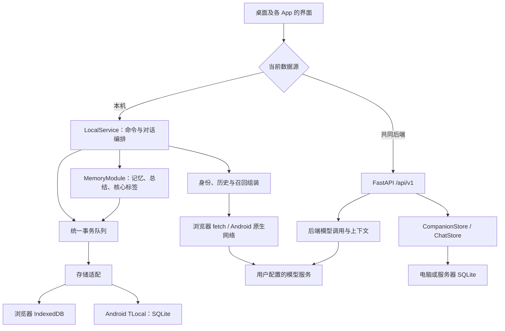

# 当前架构、数据流与扩展路线

2026-10-21：像素世界参考已 Fork 到 Jcin004/InternalBeyond（合集中的像素房间）和 Jcin004/Alicization-Town（补充的多人世界参考）；代码适配评估、两个星露谷 Mod 的只读检查、画风与下一阶段验收见 [像素世界参考交接](PIXEL_WORLD_REFERENCES.md)。本轮没有移植运行代码或更改 APK。

2026-10-20：Android 已把 OB 存储与召回核心内置 APK，SQLite 为唯一业务底账，派生 OB 缓存自动校正，无需外接记忆服务。完整数据流、迁移和测试见 [Android 内置记忆](ANDROID_EMBEDDED_MEMORY.md)。网页保留此前本地召回及可选 [OB 只读网关原型](OB_MEMORY_GATEWAY.md)，后续再统一。Latent 尚未接入。产品目标保持“人物在持续世界中生活，用户与之发生关系”。

基线：`feat/chat-mvp` 的 `199dc76`（0.6.1），审计日期 2026-10-16；本机并发写入修复见下文。本文描述实际代码。`ARCHITECTURE.md`、`MODULE_DESIGN.md`、`INTERFACE_DESIGN.md` 保留早期总体愿景；其中的“一个核心”和“尚无记忆”等描述不能直接当作当前实现。

## 现在是什么

T- 是原生 JavaScript 小手机界面，加上 Android 的 Capacitor/Java 适配，以及可选的 FastAPI 后端。它还没有使用 React，也不是全原生 Android UI。

**手机默认自己保存数据并调用模型；FastAPI 是另一种可选数据源，不是手机必经的主脑。** 两种模式没有自动同步，目前不具备跨设备共享同一份人物状态的能力。本机网页与 APK 的数据也各自独立。



日志单独管理：DiagnosticStore 在浏览器使用另一个 IndexedDB，在 Android 使用同一 SQLite 数据库的独立 diagnostics 表。Android 密钥是 SharedPreferences 中的密文，由 Keystore 保护；聊天正文不因此获得数据库整体加密。浏览器密钥存 localStorage；后端密钥在服务器 SQLite 配置中，需保护目录和备份。

## 部署方式

| 方式 | 实际运行位置 | 数据和联网 |
|---|---|---|
| 本机网页 | 静态 HTML/CSS/JS；可由 FastAPI 或静态服务器提供 | IndexedDB；浏览器直接请求模型，需要服务商允许 CORS |
| Android APK | 内置网页 + Capacitor + Java 插件 | 手机 SQLite/Keystore；原生 HTTPS 模型请求，不依赖 Windows，也不受浏览器 CORS 限制 |
| 共同后端 | Python/FastAPI 常驻进程 | 服务器 SQLite；服务器请求模型，手机/网页通过后端接口访问 |
| Netlify/Vercel 静态托管 | 可承载构建后的前端 | 不会自动变成共享数据库，也不会替你运行当前 Python 服务或保持后台自主生活 |

外部依赖：用户选择的 OpenAI Chat Completions 兼容服务、Android 系统 TTS、GitHub 代码托管。0.7.0 通过独立公开试用 Release 提供更新；签名 APK、清单和源码需一起发布，仓库公开本身不代表安装包已更新。当前没有摄像头、定位、屏幕采集、MCP、自主唤醒或通知推送的运行能力。

## 与参考项目的区别

以下对比只覆盖检查过的文件，不评价“哪套人格或记忆最好”。复用文件与许可见根目录 `THIRD_PARTY_NOTICES.md`。

| 项目 | 检查到的组织方式 | T- 当前的差别与借鉴范围 |
|---|---|---|
| float | React/Next.js，Dexie 等本地存储工具，功能较多的虚拟手机 | T- 界面更轻，但尚无成熟组件体系；已导入独立 SSE 解析与模型 JSON 包装清理，没有搬入其全部聊天/记忆模块或素材 |
| SullyOS | React/Vite + Capacitor；同时有设备、剧情和云服务相关模块 | T- 尚无同等剧情、感知和应用生态；相似的桌面外观不代表同一架构。本轮未复制其受限制代码 |
| AionsHome | 原生 JS 多页面 + FastAPI/SQLite/WebSocket，以常驻电脑服务支撑记忆、摄像头、定位等 | T- 默认手机离线于电脑仍可运行，但缺少其服务器统一调度和多端连续性；感知能力将来需独立模块和权限，而不是加到聊天按钮中 |
| Serein | 服务端来源/版本/证据及召回管线 | T- 仅移植词频/BM25 核心，在手机本地运行；没有整体接入服务、重排器和整理管线 |
| Ombre-Brain | Python 记忆系统，含存储、策略、BM25/jieba、向量等能力 | Android 内置其原版存储、BM25、模糊排序和浮现策略；不启用服务端、向量、梦境和自主任务。网页暂用原词法召回 |

核对来源：[float package.json](https://github.com/Jcin004/float/blob/c1b0ea74d7690beae31bc7c9e2a8c382fa4b151b/package.json)、[SullyOS package.json](https://github.com/Jcin004/SullyOS/blob/master/package.json)、[AionsHome 项目档案](https://github.com/Jcin004/AionsHome/blob/main/README.md)。记忆项目的具体固定提交与文件在复用记录中。

## 数据从哪里来，由谁处理和修改

| 数据 | 产生者 | 处理/写入责任 | 保存位置与修改权限 |
|---|---|---|---|
| 名册 Canon/Persona | 用户输入或明确导入 | 名册操作，校验后保存 | 当前数据源；用户明确编辑，聊天/总结模型无权改写 |
| 联系人偏好 | 用户创建聊天、修改备注/声音等 | 联系人操作 | 当前数据源的会话记录；聊天只读取人物资料，不接管名册 |
| 原始消息和生成状态 | 用户输入、模型流、程序状态机 | 对话编排；保存请求标识与完整/失败状态 | 当前数据源；记忆整理只能读取完成来源，不改原话 |
| 草稿 | 用户输入 | LocalService 草稿查询/保存命令 | 本机草稿；UI 不直接修改共享数据 |
| 记忆条目 | 用户手工选择或模型候选 | MemoryModule 逐字核验来源后提交 | 当前本机数据源；可编辑、停用和删除，原消息保留 |
| 每日总结 | 某人物当天的原始消息 | 独立总结操作，重写从原文出发 | 本机，保留最近十个旧版；不是自动确认的事实或长期记忆 |
| 核心标签 | 名册原文、模型解读、用户编辑 | 自我操作；人工编辑受保护 | 本机；目前帮助校对名册解读，不驱动自主成长 |
| API 配置/密钥 | 用户设置 | 连接管理和凭据适配 | 密钥不进入普通备份、模型上下文或源码；存储差异见上文 |
| 运行日志 | 请求与错误入口 | DiagnosticStore 脱敏并限量保留 | 仅当前设备；可能含聊天原文，导出后仍是私人资料 |
| 源码包 | 审核后的代码提交 | 发布/源码导出模块 | 已提交快照；源码接口不打包运行目录中的未跟踪文件 |

发送一条消息时：读取当前联系人和名册 → 读取配置范围内的已完成历史 → 召回该人物可用记忆并核对证据 → 组装上下文 → 通过所选连接调用模型 → 保存流与轮次状态 → 完成后才按设置考虑记忆整理。API 密钥仅用于传输认证。人物关联不改变知情范围，也不自动生成反向关系。

## 已发现的问题与处理顺序

| 优先级 | 证据与影响 | 更合适的方案 / 本次状态 |
|---|---|---|
| P0：原仓库公开前阻断 | 47 个提交含私人邮箱；Actions 元数据重复保留邮箱；历史文档有真实 LAN 地址 | 已将审核快照以单个 noreply 初始提交发布到公开 T-companion；原 T- 保持私有并保留历史 |
| P1：并发写入所有权不完整 | 隔离复现：记忆保存失败回滚后，已排队的草稿快照仍能把候选写入磁盘，内存 0 条、磁盘 1 条 | 已修复单个 LocalService 内的写入：排队后从已保存状态复制，校验并保存成功后发布；模型生成在队列外，入队提交时再次核对来源 |
| P1：源码打包范围 | 原 source.py 递归目录，隔离测试证实未跟踪的 backend/private.env 会进入导出 | 本次改为验证仓库根目录后导出确定提交；非 Git 安装明确要求随包源码，拒绝遍历父仓库或运行目录 |
| P2：界面越过业务接口 | 草稿已使用命令；原上下文预览、来源跳转和外观直接读取内部数据 | 本轮新增只读查询，界面改走查询；聊天与预览复用同一上下文组装 |
| P2：大模块职责交叉 | app.js 约 36 KB 同时处理导航、聊天、名册、设置、导出；LocalService 兼有协议分发、上下文、存储与传输 | 按“对话编排、资料查询、连接管理、持久化适配”逐步收口；不按每个按钮拆文件 |
| P2：平台语义分叉 | 本机 JS 与后端 Python 分别构建上下文和校验；仅运行约束已有一致性测试 | 用共同数据契约和场景用例约束两种实现，声明能力差异；不为共享代码强迫手机依赖服务器 |
| P2：大数据与生命周期 | 本机 SQLite/IndexedDB 保存整份 JSON；流中周期性复制全量；自动整理只有一个全局 timer | 先统一写入，再评估分实体存储与迁移；多人物调度改为有所有者的任务，不把 timer 当后台生活引擎 |
| P2：维护入口漂移 | 早期架构文档与当前状态不同；两个许可生成脚本；CI 原先只覆盖特定 PR 基础分支 | 本文成为当前入口；CI 改为检查所有 PR；旧脚本清理随下一次相关改动处理，Node 构建入口为当前有效入口 |

### 本机写入契约

`LocalService.transact(change)` 是本机业务文档的唯一保存入口。命令按顺序执行，每次从上一份已保存状态复制私有副本；校验或保存失败就丢弃副本，后续命令继续从原状态开始。只有存储适配确认成功，才更新可查询的数据。返回值也复制，调用者不持有内部可变对象。

名册、联系人、设置、草稿、备份恢复与记忆提交共用此队列。记忆模块只修改传入的副本；模型生成不持有写入队列，生成完成后在事务开始处重新核对来源原文或名册。流式回复按请求标识保存阶段快照，每次查找最新消息，不跨保存持有可变引用；完成前等待阶段写入结果，失败不能显示完成。

草稿使用本机 `GET/PATCH /contacts/{id}/draft`，格式为 `{text}`。UI 的 localStorage 仍是关闭页面时的快速保留层，业务文档写入必须经过命令。文档格式仍为 version 2，无需迁移。

此队列协调一个 LocalService 实例；多个浏览器标签页、独立实例或设备之间尚无锁与冲突合并。密钥仍由独立凭据适配管理，凭据和业务文档之间没有跨存储事务，配置保存失败后可能需要重新填写密钥。日志也使用独立存储。共同后端继续使用自身 SQLite 事务，本次没有改变其协议。

验证覆盖失败记忆后续写入、草稿顺序、回复与草稿交错、首次保存失败、流式阶段失败、恢复失败、排队名册编辑使旧分析失效；另以真实 IndexedDB 验证保存及刷新。Android 存储适配故障测试使用模拟插件，不等于真机空间不足实测。

## 本机只读查询

`frontend/local-queries.js` 集中读取人物、名册原文、外观、上下文和来源位置。界面调用 `LocalService.api`，查询不会进入写入队列、读取密钥或调用模型。实际聊天与预览共同调用其中的 `buildContext`；旧 `local-service.js` 导出路径继续保留。

| 路径 | 返回与约束 |
|---|---|
| `GET /characters/{id}` | 人物快照，修改返回值不会改动名册 |
| `GET /characters/{id}/identity-source` | `{text}`：名册证据原文，自我编辑器不再自己拼接 |
| `GET /appearance` | 只返回外观字段，不返回模型地址或配置 |
| `POST /contacts/{id}/context-preview` | 输入 `{message}`，返回说明与上下文消息；允许空草稿，最多 20000 字符；不修改已保存草稿 |
| `GET /memory-sources/{messageId}/location?owner={characterId}` | 返回该人物已完成来源消息及其联系人；不受来源选择器最近 300 条限制 |

记忆卡片、历史版本和每日总结的来源链接都携带所属人物。人物关联不授予其他人物来源读取或召回资格。共同后端没有新增这些接口；现有界面仍只在本机模式使用它们，外观继续使用本机设置。

逐文件职责见 [文件地图](FILE_MAP.md)，开发时的已有行为清单见 [功能回归基线](FEATURE_BASELINE.md)。

## 记忆关联第一版

本机新增 `memory.links`，由独立关系规则模块校验，MemoryModule 经统一事务写入，关联界面只调用接口。支持四类记忆间关系，以及记忆到核心标签的依据连接；关系必须在同一人物内，保留方向、说明和端点版本。端点修改后提示复核，删除端点时同事务清理相连边；已手动关联的 AI 标签在重分析时保留。旧记录可补空关联和版本 0。

本轮仅完成关系管理与来源回溯，没有改变 BM25 召回、上下文或人格行为，没有新增远程记忆、自动关系提议或完整图谱画布。使用、兼容和复用检查见 [记忆关联说明](MEMORY-LINKS.md)。

## 接下来怎样扩展

本机写入队列、草稿命令和上述资料查询已完成。下面是后续领域拆分的职责建议，并非新接口清单：

```text
聊天 → roster.getProfile(characterId)       只读身份快照
聊天 → messages.getCompletedSources(...)    只读完成来源
聊天 → memory.recall(owner, query, budget)   只读候选/证据
各领域 → localService.transact(change)        已实现的本机写入协调入口
编排 → model.generate(profileId, context)    模型传输，不拥有身份
未来感知 → observation.submit(event)         独立设备权限与观察，不直接改记忆
```

| 后续需求 | 扩展位置 | 先满足的条件 |
|---|---|---|
| 记忆网/自我成长 | 记忆与自我领域 | 唯一写入口、版本/证据契约；客观事件与主观解读分开；标签与事件连线由明确关系表示 |
| 世界与 NPC | 世界状态模块 | 稳定人物标识、事件及观察者范围；世界事实经验证提交，不能由聊天旁白直接宣布 |
| 剧情 | 独立剧情空间 | 日常状态与故事状态分区；只经明确规则写回“共同经历过剧情” |
| 屏幕/定位/摄像头 | 设备观察适配 | 独立权限、采集开关、来源和保留规则；聊天只消费被允许的观察摘要 |
| 自主唤醒 | 调度与任务模块 | 明确常驻宿主、去重、取消、成本/打扰策略；APK 关闭后普通 JS 计时器不能保证运行 |
| 桌面小人 | 新交互端 | 复用领域查询与对话命令；不要再复制一套人物/记忆逻辑 |
| 多端连续性 | 同步协议或明确的共同后端 | 数据所有者、全局标识、版本、冲突与离线规则；不能把切换地址说成同步 |

React 可在界面状态复杂到需要组件体系时评估；现在首先修清数据所有权和写入方式。换框架不能自动修复这些问题。


## 模型连接分工与悬浮切换

本机模式（网页、Android）已有多连接与文件夹分组，每个预设包含服务地址、模型名和独立凭据。`active_profile_id` 是当前聊天使用的连接；不是每个人物各自绑定的连接。App 内 API 悬浮球和聊天页切换按钮共用选择弹窗及 `/model-profiles/:id/activate`，不新增一份配置。悬浮球只保存 UI 位置到本机 localStorage，不提供 Android 系统悬浮窗，也不在其他软件上显示。共同后端模式隐藏该入口。

`memory.settings.profile_id` 是记忆整理、每日总结、自我标签分析共用的专用连接，可在「记忆 → 召回与整理设置」选择；空值表示跟随当前聊天连接。更换聊天连接不修改此字段。专用连接被删除时，整理会明确失败，要求重新选择，不会悄悄向另一家服务发送原文。已有请求进行时禁止切换连接；日志沿用实际连接、模型和用途。BM25 召回在本地完成，不调用模型或 embedding 服务。记忆分析与聊天共用单个活动请求协调器，不是并行后台多 Agent。

参考对比（只参考结构，本次未导入代码）：float 的固定提交 `c1b0ea74d7690beae31bc7c9e2a8c382fa4b151b` 中，`lib/settings-storage.ts` 的 `resolveAuxiliaryApiConfig()` 分别支持总结、embedding、桌宠、推理翻译、问答等用途，并回退至全局默认连接；`lib/memory-summarizer.ts` 使用总结绑定。我们目前将整理/总结/自我分析合用一个记忆连接，尚未为每个用途逐项绑定。SullyOS 上游的 `types.ts` 和 README 还区分 embedding、视觉与语音等配置，不能把这些接口都当成第二个聊天模型。

来源：[float 连接解析](https://github.com/Jcin004/float/blob/c1b0ea74d7690beae31bc7c9e2a8c382fa4b151b/lib/settings-storage.ts)、[float 总结管线](https://github.com/Jcin004/float/blob/c1b0ea74d7690beae31bc7c9e2a8c382fa4b151b/lib/memory-summarizer.ts)、[SullyOS 类型](https://github.com/qegj567-cloud/SullyOS/blob/master/types.ts)、[SullyOS 说明](https://github.com/qegj567-cloud/SullyOS)。

## 0.8.0 本机召回扩展

已复核的记忆关联与人工核心标签参与本机聊天：Serein 词法检索加近期用户线索、同人物单跳关联、共用预算与召回回执。证据逻辑移到 memory-evidence，候选策略集中在 memory-recall；预览和实际发送使用同一计划，原 API 与数据保留。详见 [本机记忆网召回](MEMORY_RECALL.md)。仍未接入向量检索、自动人格成长或 Python 共同后端的新召回。

## 0.8.1 设置收尾与群像归属

上下文范围已有全局默认与单联系人覆盖；当前一个人物重复发起聊天复用同一联系人，因此界面称为“此人物聊天独立设置”。联系人值为 null 时跟随全局。界面输入不再禁用，编辑数字自动切为独立模式，选择跟随时恢复全局显示值；保存仍复用原验证/事务接口，不迁移数据。

模型连接、外观、聊天偏好分别由 model-profiles-ui、appearance-ui、chat-settings-ui 挂载；preferences-ui 保留兼容入口。对话框返回集中在 dialog-navigation，沿用系统 dialog 生命周期。旧 app.js 仍负责聊天导航与编排，不表示所有历史 UI 已独立。

多人事件、群聊、社会关系和世界运行统一属于未来像素世界阶段，不在当前个人记忆阶段提前开发。个人身份、记忆和模型连接仍有各自的数据所有者；世界读取这些接口，不复制或接管它们。生活状态、欲望和自主唤醒仍在像素世界之后。

## 0.9.0 记忆关联候选

MemoryLinkProposalService 复用 MemoryModule 的模型生成/取消与事务接口，纯候选规则放在 memory-link-proposals，界面独立于已复核关系编辑。memory.link_proposals 不属于召回输入；人工确认事务才创建 memory.links，并保留候选原理由、引文和当时人工修改结果。旧备份补空数组，原文/身份/凭据不变；共同后端不提供本次功能。候选材料仅来自显式勾选的同人物记忆及人工标签，源消息与名册证据分别核对，不扩展知情范围。详见 MEMORY_LINK_PROPOSALS.md。
