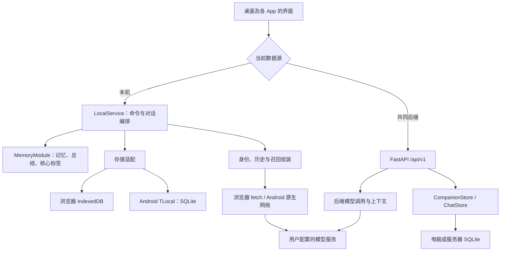

# 当前架构、数据流与扩展路线

基线：`feat/chat-mvp` 的 `199dc76`（0.6.1），审计日期 2026-10-16。本文描述实际代码。`ARCHITECTURE.md`、`MODULE_DESIGN.md`、`INTERFACE_DESIGN.md` 保留早期总体愿景；其中的“一个核心”和“尚无记忆”等描述不能直接当作当前实现。

## 现在是什么

T- 是原生 JavaScript 小手机界面，加上 Android 的 Capacitor/Java 适配，以及可选的 FastAPI 后端。它还没有使用 React，也不是全原生 Android UI。

**手机默认自己保存数据并调用模型；FastAPI 是另一种可选数据源，不是手机必经的主脑。** 两种模式没有自动同步，目前不具备跨设备共享同一份人物状态的能力。本机网页与 APK 的数据也各自独立。



日志单独管理：DiagnosticStore 在浏览器使用另一个 IndexedDB，在 Android 使用同一 SQLite 数据库的独立 diagnostics 表。Android 密钥是 SharedPreferences 中的密文，由 Keystore 保护；聊天正文不因此获得数据库整体加密。浏览器密钥存 localStorage；后端密钥在服务器 SQLite 配置中，需保护目录和备份。

## 部署方式

| 方式 | 实际运行位置 | 数据和联网 |
|---|---|---|
| 本机网页 | 静态 HTML/CSS/JS；可由 FastAPI 或静态服务器提供 | IndexedDB；浏览器直接请求模型，需要服务商允许 CORS |
| Android APK | 内置网页 + Capacitor + Java 插件 | 手机 SQLite/Keystore；原生 HTTPS 模型请求，不依赖 Windows，也不受浏览器 CORS 限制 |
| 共同后端 | Python/FastAPI 常驻进程 | 服务器 SQLite；服务器请求模型，手机/网页通过后端接口访问 |
| Netlify/Vercel 静态托管 | 可承载构建后的前端 | 不会自动变成共享数据库，也不会替你运行当前 Python 服务或保持后台自主生活 |

外部依赖：用户选择的 OpenAI Chat Completions 兼容服务、Android 系统 TTS、GitHub 代码托管。更新下载渠道未发布；仓库公开和发布可更新 APK 是两个操作。当前没有摄像头、定位、屏幕采集、MCP、自主唤醒或通知推送的运行能力。

## 与参考项目的区别

以下对比只覆盖检查过的文件，不评价“哪套人格或记忆最好”。复用文件与许可见根目录 `THIRD_PARTY_NOTICES.md`。

| 项目 | 检查到的组织方式 | T- 当前的差别与借鉴范围 |
|---|---|---|
| float | React/Next.js，Dexie 等本地存储工具，功能较多的虚拟手机 | T- 界面更轻，但尚无成熟组件体系；已导入独立 SSE 解析与模型 JSON 包装清理，没有搬入其全部聊天/记忆模块或素材 |
| SullyOS | React/Vite + Capacitor；同时有设备、剧情和云服务相关模块 | T- 尚无同等剧情、感知和应用生态；相似的桌面外观不代表同一架构。本轮未复制其受限制代码 |
| AionsHome | 原生 JS 多页面 + FastAPI/SQLite/WebSocket，以常驻电脑服务支撑记忆、摄像头、定位等 | T- 默认手机离线于电脑仍可运行，但缺少其服务器统一调度和多端连续性；感知能力将来需独立模块和权限，而不是加到聊天按钮中 |
| Serein | 服务端来源/版本/证据及召回管线 | T- 仅移植词频/BM25 核心，在手机本地运行；没有整体接入服务、重排器和整理管线 |
| Ombre-Brain | 服务式记忆系统，含 BM25/jieba、向量等检索能力 | T- 仍是稀疏关键词检索，不是混合或向量检索；未引入其 Python 常驻服务 |

核对来源：[float package.json](https://github.com/Jcin004/float/blob/c1b0ea74d7690beae31bc7c9e2a8c382fa4b151b/package.json)、[SullyOS package.json](https://github.com/Jcin004/SullyOS/blob/master/package.json)、[AionsHome 项目档案](https://github.com/Jcin004/AionsHome/blob/main/README.md)。记忆项目的具体固定提交与文件在复用记录中。

## 数据从哪里来，由谁处理和修改

| 数据 | 产生者 | 处理/写入责任 | 保存位置与修改权限 |
|---|---|---|---|
| 名册 Canon/Persona | 用户输入或明确导入 | 名册操作，校验后保存 | 当前数据源；用户明确编辑，聊天/总结模型无权改写 |
| 联系人偏好 | 用户创建聊天、修改备注/声音等 | 联系人操作 | 当前数据源的会话记录；聊天只读取人物资料，不接管名册 |
| 原始消息和生成状态 | 用户输入、模型流、程序状态机 | 对话编排；保存请求标识与完整/失败状态 | 当前数据源；记忆整理只能读取完成来源，不改原话 |
| 草稿 | 用户输入 | 草稿命令（目标接口）；当前仍存在 UI 直接写入 | 本机草稿；审计中要求迁移至统一写入口 |
| 记忆条目 | 用户手工选择或模型候选 | MemoryModule 逐字核验来源后提交 | 当前本机数据源；可编辑、停用和删除，原消息保留 |
| 每日总结 | 某人物当天的原始消息 | 独立总结操作，重写从原文出发 | 本机，保留最近十个旧版；不是自动确认的事实或长期记忆 |
| 核心标签 | 名册原文、模型解读、用户编辑 | 自我操作；人工编辑受保护 | 本机；目前帮助校对名册解读，不驱动自主成长 |
| API 配置/密钥 | 用户设置 | 连接管理和凭据适配 | 密钥不进入普通备份、模型上下文或源码；存储差异见上文 |
| 运行日志 | 请求与错误入口 | DiagnosticStore 脱敏并限量保留 | 仅当前设备；可能含聊天原文，导出后仍是私人资料 |
| 源码包 | 审核后的代码提交 | 发布/源码导出模块 | 已提交快照；源码接口不打包运行目录中的未跟踪文件 |

发送一条消息时：读取当前联系人和名册 → 读取配置范围内的已完成历史 → 召回该人物可用记忆并核对证据 → 组装上下文 → 通过所选连接调用模型 → 保存流与轮次状态 → 完成后才按设置考虑记忆整理。API 密钥仅用于传输认证。人物关联不改变知情范围，也不自动生成反向关系。

## 已发现的问题与处理顺序

| 优先级 | 证据与影响 | 更合适的方案 / 本次状态 |
|---|---|---|
| P0：原仓库公开前阻断 | 47 个提交含私人邮箱；Actions 元数据重复保留邮箱；历史文档有真实 LAN 地址 | 先准备清理后的发布快照。原仓库公开需另审历史和平台记录；本次没有改变可见性 |
| P1：并发写入所有权不完整 | 隔离复现：记忆保存失败回滚后，已排队的草稿快照仍能把候选写入磁盘，内存 0 条、磁盘 1 条 | 下一轮首先统一命令/事务写入；不能只让 UI 补一个重试。模型生成放事务外，验证与版本检查后原子提交 |
| P1：源码打包范围 | 原 source.py 递归目录，隔离测试证实未跟踪的 backend/private.env 会进入导出 | 本次改为验证仓库根目录后导出确定提交；非 Git 安装明确要求随包源码，拒绝遍历父仓库或运行目录 |
| P2：界面越过业务接口 | app.js 的 saveDraft、上下文预览和来源跳转直接访问 service.data/persist | 增加草稿命令、来源定位查询和上下文预览查询，逐处替换；不新增绕行路径 |
| P2：大模块职责交叉 | app.js 约 36 KB 同时处理导航、聊天、名册、设置、导出；LocalService 兼有协议分发、上下文、存储与传输 | 按“对话编排、资料查询、连接管理、持久化适配”逐步收口；不按每个按钮拆文件 |
| P2：平台语义分叉 | 本机 JS 与后端 Python 分别构建上下文和校验；仅运行约束已有一致性测试 | 用共同数据契约和场景用例约束两种实现，声明能力差异；不为共享代码强迫手机依赖服务器 |
| P2：大数据与生命周期 | 本机 SQLite/IndexedDB 保存整份 JSON；流中周期性复制全量；自动整理只有一个全局 timer | 先统一写入，再评估分实体存储与迁移；多人物调度改为有所有者的任务，不把 timer 当后台生活引擎 |
| P2：维护入口漂移 | 早期架构文档与当前状态不同；两个许可生成脚本；CI 原先只覆盖特定 PR 基础分支 | 本文成为当前入口；CI 改为检查所有 PR；旧脚本清理随下一次相关改动处理，Node 构建入口为当前有效入口 |

这里没有宣称并发问题已修复。它应在继续做记忆网、自动唤醒或跨设备写入前处理，避免在不稳定写入上增加状态。

## 接下来怎样扩展

先完成存储写入与资料查询接口，再扩展能力。下面是职责建议，并非已经实现的接口：

```text
聊天 → roster.getProfile(characterId)       只读身份快照
聊天 → messages.getCompletedSources(...)    只读完成来源
聊天 → memory.recall(owner, query, budget)   只读候选/证据
各领域 → store.transact(command)             唯一写入协调入口
编排 → model.generate(profileId, context)    模型传输，不拥有身份
未来感知 → observation.submit(event)         独立设备权限与观察，不直接改记忆
```

| 后续需求 | 扩展位置 | 先满足的条件 |
|---|---|---|
| 记忆网/自我成长 | 记忆与自我领域 | 唯一写入口、版本/证据契约；客观事件与主观解读分开；标签与事件连线由明确关系表示 |
| 世界与 NPC | 世界状态模块 | 稳定人物标识、事件及观察者范围；世界事实经验证提交，不能由聊天旁白直接宣布 |
| 剧情 | 独立剧情空间 | 日常状态与故事状态分区；只经明确规则写回“共同经历过剧情” |
| 屏幕/定位/摄像头 | 设备观察适配 | 独立权限、采集开关、来源和保留规则；聊天只消费被允许的观察摘要 |
| 自主唤醒 | 调度与任务模块 | 明确常驻宿主、去重、取消、成本/打扰策略；APK 关闭后普通 JS 计时器不能保证运行 |
| 桌面小人 | 新交互端 | 复用领域查询与对话命令；不要再复制一套人物/记忆逻辑 |
| 多端连续性 | 同步协议或明确的共同后端 | 数据所有者、全局标识、版本、冲突与离线规则；不能把切换地址说成同步 |

React 可在界面状态复杂到需要组件体系时评估；现在首先修清数据所有权和写入方式。换框架不能自动修复这些问题。
